<p align="center">
  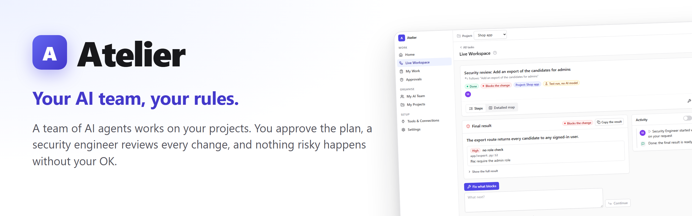
</p>

<p align="center">
  <b>A team of AI agents that works on your projects, with you in charge.</b><br>
  Claude Code · Gemini CLI · Codex · GitHub Copilot · Cursor · goose · OpenCode · Qwen Code · Mistral Vibe · any ACP agent
</p>

<p align="center">
  
  
  
  
  
</p>

<p align="center">
  <a href="#see-it-in-30-seconds">See it</a> ·
  <a href="#what-you-get">Features</a> ·
  <a href="#agents-it-runs-on">Agents</a> ·
  <a href="#quick-start">Quick start</a> ·
  <a href="docs/TOUR.md">Full tour</a> ·
  <a href="#faq">FAQ</a> ·
  <a href="docs/LICENSING.md">Get a licence</a>
</p>

---

**Atelier** is a workshop for AI agents that runs on your own machine. You say what you want in plain words. The
right specialist does the work in your project folder, a security engineer reviews every code change, and nothing
risky happens without your OK.

It works with the agents you already pay for: each team member runs on Claude Code or on any agent that speaks the
open [Agent Client Protocol](https://agentclientprotocol.com), each on its own sign-in. **Atelier never asks for an
API key.**

## See it in 30 seconds

| 1. Say what you want | 2. Approve the plan | 3. Get reviewed work |
|---|---|---|
| [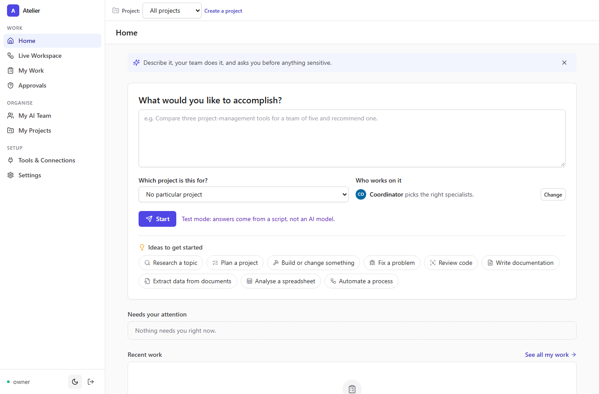](docs/assets/screens/home.png) | [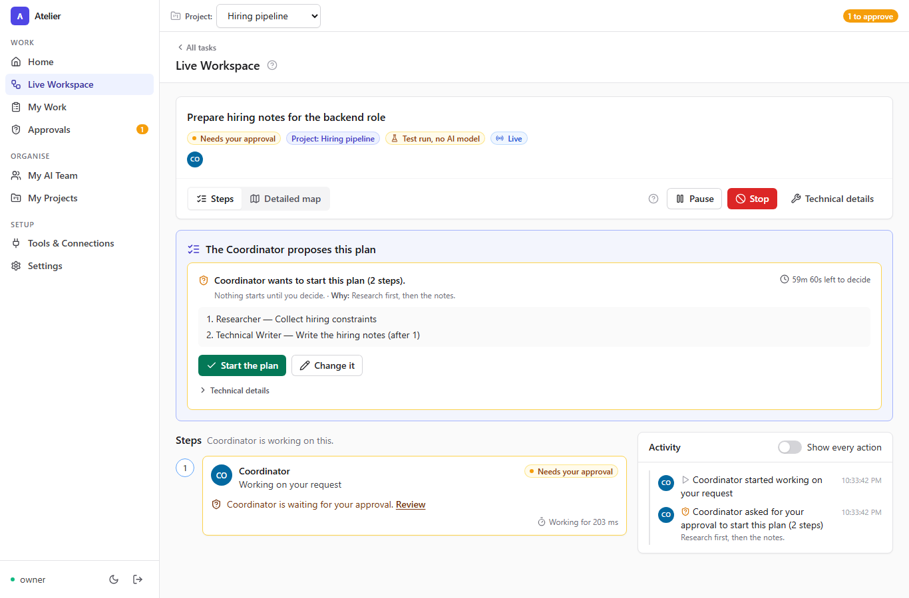](docs/assets/screens/plan.png) | [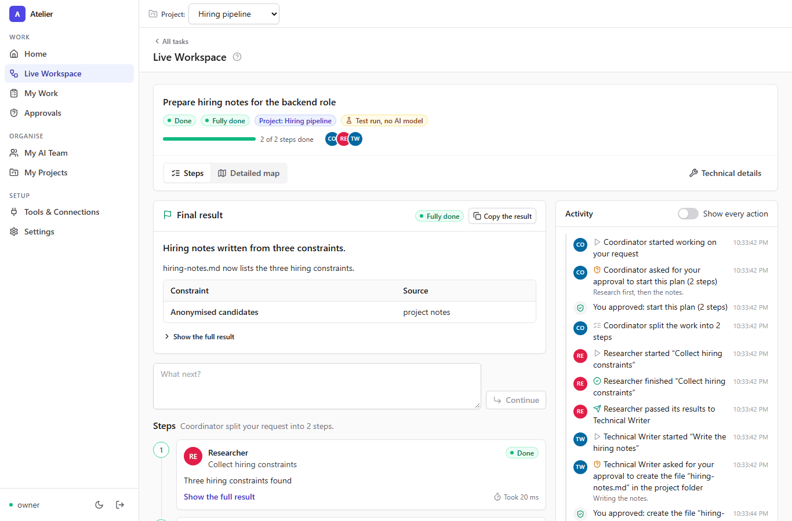](docs/assets/screens/result.png) |
| One box, plain words. Pick a project, or let the Coordinator choose who works on it. | Nothing starts before you check the plan: who does what, in which order. Change it with one sentence. | The final result, every step's output and a live activity feed, all from the real run. |

<sub>Screens from Atelier's own browser tests, run on a labelled test double (no AI model).</sub>

## What you get

### A whole team, not one chatbot

Fifteen specialists with clear jobs: Coordinator, Software Engineer, Security Engineer, Architect, Debugger, Tester,
Code Reviewer, Deployer, Researcher, Planner, Technical Writer, Data Analyst, Document Specialist, Automation
Specialist and Grader. Each profile says when it helps, what it can do, what it won't do and what you get back.
You can change their rules or create your own members, either in the interface or as a TOML file.

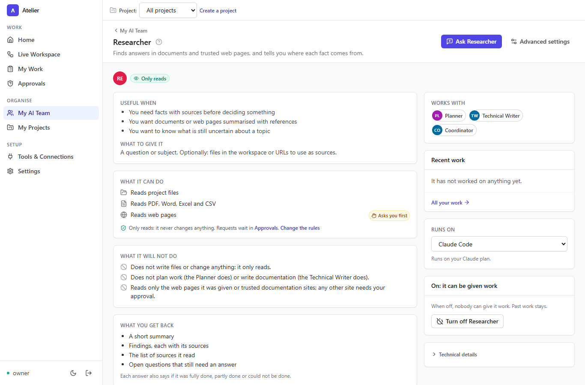

### Plans you approve, work you can follow

For bigger goals the Coordinator splits the work and proposes a plan. Work starts only once you approve it. The
Live Workspace then shows who works on what, what each member hands to the next, and every approval, as it
happens. Experts can open the detailed map.

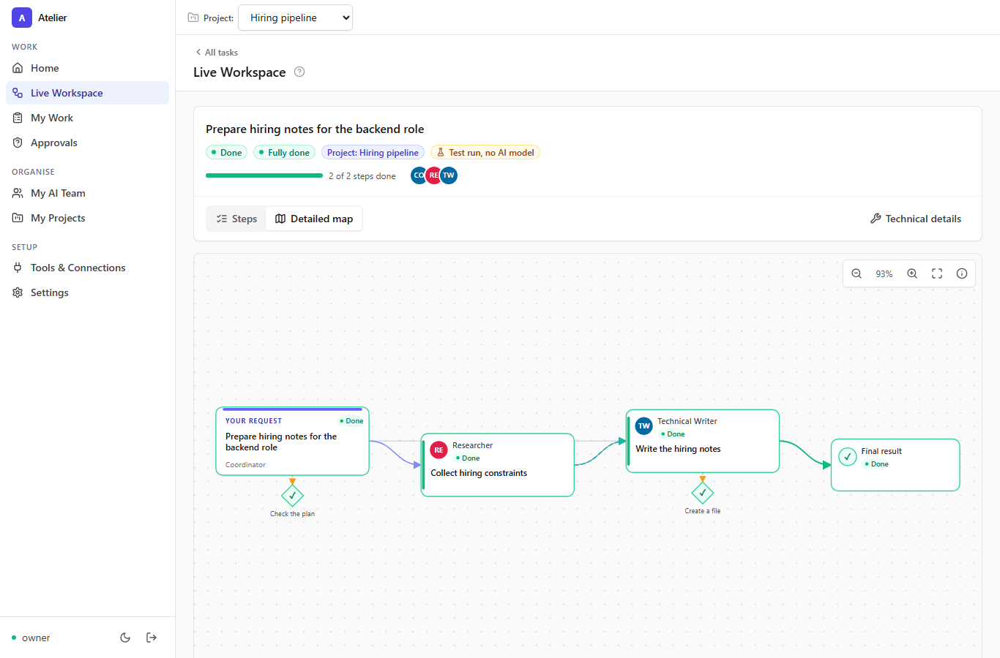

### One gate for every action

Every action an agent asks for goes through one permission gate. Reading is free. Editing files and running
commands wait for you in **Approvals**, with the exact file, content or command in plain words. You can switch on
auto mode and let the work run. Deploys, `git push`, publishing and anything that sends data off your machine still
ask, unless you say otherwise. Private folders and secret files are always closed.

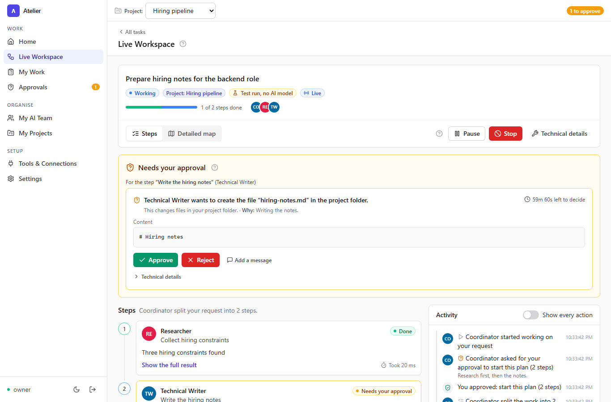

### Every code change gets a security review

When a change lands, a read-only Security Engineer reviews it and gives a verdict: *nothing blocks*, *passed with
warnings*, or **blocks the change**. Each finding comes with its file, line, exploit and fix. **Fix what blocks**
sends it straight back to the engineer, and the review runs again.

| Blocked | Fixed and re-reviewed |
|---|---|
| [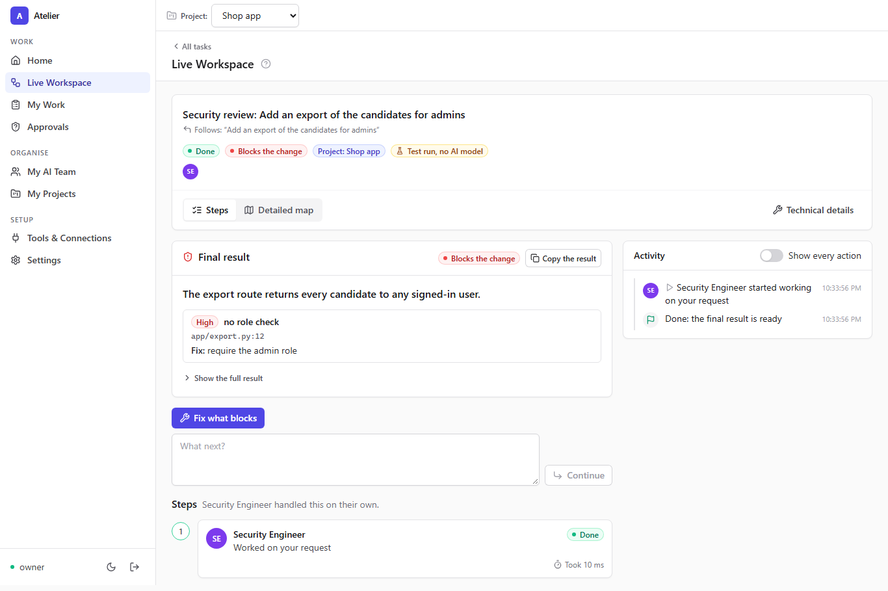](docs/assets/screens/security-review.png) | [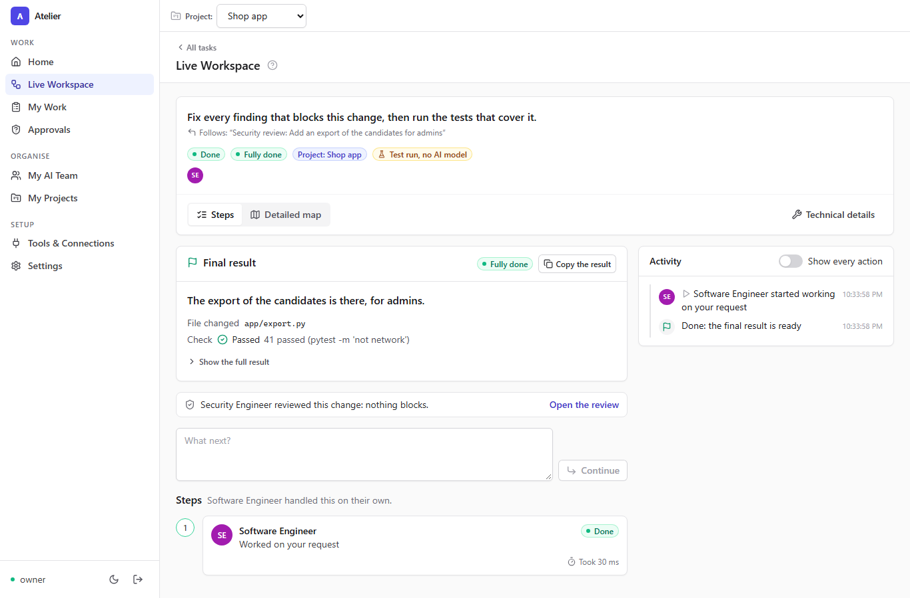](docs/assets/screens/review-fixed.png) |

### Any agent, no API keys, no surprise bills

You choose the agent for each team member: the Software Engineer on Claude Code, the Researcher on Gemini CLI, the
Tester on Codex. Tools & Connections shows what is installed and how to sign in. Atelier starts each agent without
its vendor's API keys, and it stops a Claude run instead of spending paid usage credits.

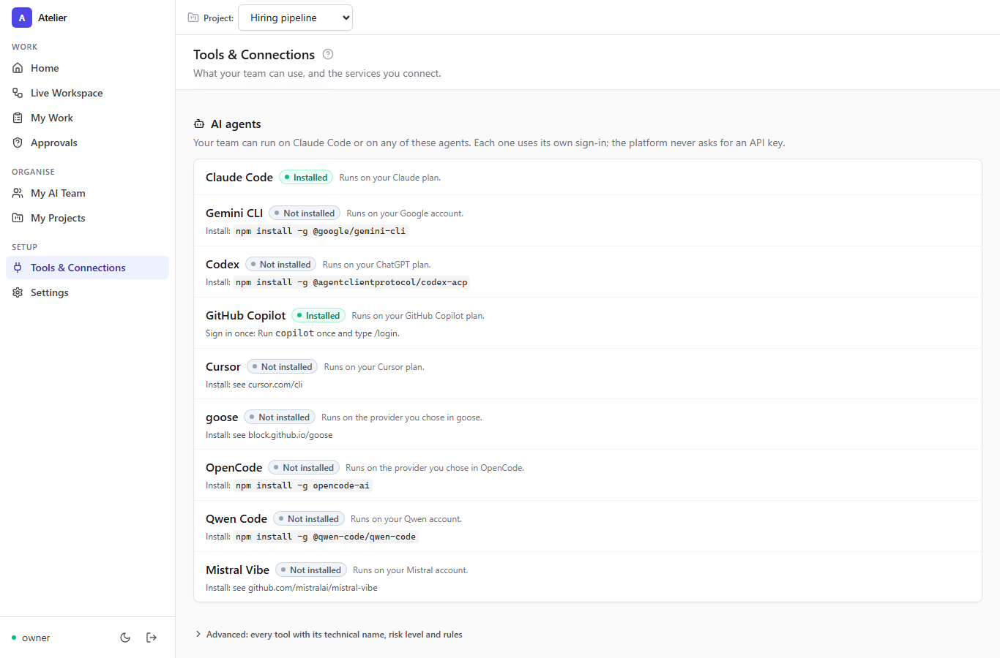

### Works on code like a coding agent

In a code project, your request goes straight to the Software Engineer, which works in your repository like a
Claude Code session. It follows your style, runs your tests and keeps its session for follow-ups. The Coordinator is
one click away when you want the whole team.

### And everything else a serious tool needs

- **Projects:** each project keeps its own folder, notes, secrets and history, kept apart from the others. You can mark folders as private.
- **History:** My Work lists every task, its follow-ups and results, with search and filters.
- **Recovery:** a task interrupted by a restart can be resumed, and time spent waiting for you never counts against its limits.
- **App watcher:** Atelier checks your running app's containers every 2 minutes. On a problem it sends a Windows notification and starts a read-only diagnosis.
- **Notifications:** Windows tells you when a task ends or waits for you.
- **Extensible:** add your own tools, MCP servers and agents.
- **Comfortable:** light and dark screens, plain language everywhere, phone-width layouts.

## How it works

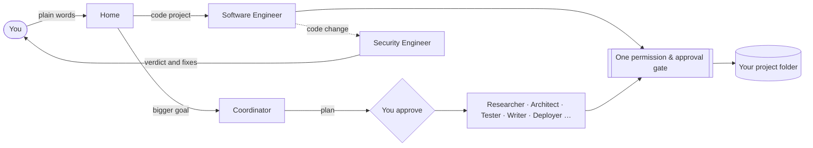

Each team member runs on **Claude Code** or on **any ACP agent**. Atelier is the client for the agent, so the agent's
edits, commands and file access go through the same gate, whichever vendor made it.

## Why not just one coding agent?

| | A coding agent on its own | Atelier |
|---|:---:|:---:|
| Edits code in your repo, asks before risky actions | ✓ | ✓ |
| Named specialists with clear roles and hand-offs (research, design, tests, docs, data, deploys) | partly | ✓ |
| A plan you approve, then the work spread across the team | partly | ✓ |
| An automatic security review of every code change, with a verdict and fixes | — | ✓ |
| One permission gate and approvals inbox for agents from different vendors | — | ✓ |
| Mix agents from different vendors in one team | — | ✓ |
| Live view of who does what, and a searchable history of every task | partly | ✓ |
| Project folders, secrets and history kept apart | — | ✓ |

Atelier doesn't replace your coding agent. It runs it, alongside the others, under your rules.

## Agents it runs on

| Agent | Runs on | Install it |
|---|---|---|
| Claude Code | Your Claude plan | Built in: sign in once from Settings |
| Gemini CLI | Your Google account | `npm install -g @google/gemini-cli` |
| Codex | Your ChatGPT plan | `npm install -g @agentclientprotocol/codex-acp` |
| GitHub Copilot | Your Copilot plan | `npm install -g @github/copilot` |
| Cursor | Your Cursor plan | [cursor.com/cli](https://cursor.com/cli) |
| goose | The provider you set in goose | [block.github.io/goose](https://block.github.io/goose) |
| OpenCode | The provider you set in OpenCode | `npm install -g opencode-ai` |
| Qwen Code | Your Qwen account | `npm install -g @qwen-code/qwen-code` |
| Mistral Vibe | Your Mistral account | [github.com/mistralai/mistral-vibe](https://github.com/mistralai/mistral-vibe) |
| Any other ACP agent | Its own sign-in | Add it in Settings with the command that starts it |

To choose a team member's agent, open the member's page and use **Runs on**. The Coordinator stays on Claude Code,
because its planning tools only work there today.

## Quick start

You need Python 3.12, Node.js 22+, Git, and at least one agent above.

```bash
cd backend
python -m venv .venv
.venv/Scripts/python -m pip install -c requirements.lock -e ".[dev]"   # .venv/bin/python on macOS and Linux
cd ../frontend
npm ci
npm run build
cd ../backend
.venv/Scripts/pae serve
```

Then:

1. Open **http://127.0.0.1:8600** and create your account with the one-time setup token printed in the log.
2. Sign Claude Code in from **Settings**, or install another agent from the table above.
3. Add a project folder and say what you want.

You can also run it with Docker: `docker compose up -d --build`. [docs/operations.md](docs/operations.md) covers
Docker, starting at logon, backups and the security scanners.

## Built for trust

- **Local-first.** Atelier runs on your machine. Your code goes only to the agents you choose, under their own terms.
- **No credentials collected.** Each agent signs in through its vendor's own flow. Atelier never sees a password or token, and it refuses to store AI vendors' model keys.
- **Secrets stay secret.** Secrets are stored encrypted and write-only, and redacted from every event, log and output.
- **Closed doors.** Paths outside the project, private folders and secret files are refused, whichever agent asks.
- **Audited.** Approvals, settings, secrets, runs and projects go into an audit log.
- **Tested.** The suites cover the permission gate, approvals, prompt-injection cases, project isolation, recovery and full browser journeys: 387 backend tests and 214 interface tests.

## Honest status

Atelier says what it hasn't proven yet. Claude Code is used for real work. The other ACP agents are tested against the
protocol with a scripted agent, but none has run live yet. [docs/STATUS.md](docs/STATUS.md) lists every capability
with its evidence and its gaps.

## FAQ

<details><summary><b>Do I need an API key?</b></summary>

No. Each agent runs on your own plan with its vendor (Claude, ChatGPT, Google, Copilot, Cursor...). Atelier never
asks for, stores or passes an API key, and it starts every agent without its vendor's keys in its environment.
</details>

<details><summary><b>Which agent should I use?</b></summary>

Use the ones you already have. Claude Code is built in and is the most proven here. Any team member except the
Coordinator can run on another agent, and you can mix agents in one team.
</details>

<details><summary><b>Can an agent do something without my OK?</b></summary>

What an agent asks to do goes through Atelier's gate: your approval, auto mode with its exceptions, and the closed
private folders. What an agent does entirely inside itself, without asking, depends on that agent's own settings.
Keep those strict.
</details>

<details><summary><b>Does my code leave my machine?</b></summary>

Only to the agents you choose to run, under their vendors' terms. Atelier itself has no cloud: your projects,
history and settings stay in your folders and one SQLite file.
</details>

<details><summary><b>Which systems does it run on?</b></summary>

Windows is tested day to day, including starting at logon and Windows notifications. A Docker image (Linux) is
verified too. macOS and native Linux use the same Python and Node stack, but they aren't verified yet.
</details>

<details><summary><b>Is it open source?</b></summary>

No. The source is public so you can read and evaluate it, and using it needs a licence. See
[docs/LICENSING.md](docs/LICENSING.md).
</details>

## Documentation

| | |
|---|---|
| [Feature tour](docs/TOUR.md) | Every screen, step by step |
| [Architecture](docs/01-architecture.md) | The design decisions and the reasons for them |
| [AI access](docs/subscription-architecture.md) | Subscriptions, never API keys, and how each agent signs in |
| [Agent Workspace](docs/agent-workspace.md) | Plans, hand-offs, approvals and the live view |
| [User experience](docs/user-experience.md) | The screens and the plain-language vocabulary |
| [Extending](docs/extending.md) | New team members, tools, MCP servers and agents |
| [Operations](docs/operations.md) | Running, Docker, logon start, backups |
| [Status](docs/STATUS.md) | What is verified, with evidence |
| [Changelog](CHANGELOG.md) | What changed, release by release |

## Licence

Atelier is proprietary software, all rights reserved. You may read the source and evaluate Atelier for 30 days on one
machine. Any other use needs a licence from the author. See [LICENSE](LICENSE), and
**[docs/LICENSING.md](docs/LICENSING.md)** to request one.

Each agent you connect is used under its own vendor's terms. Claude, Gemini, Codex, Copilot, Cursor and the other
names here belong to their owners. Atelier is not affiliated with or endorsed by any of them.
