# Feature tour

A walk through Atelier, screen by screen. Every picture comes from Atelier's own browser tests: the real interface
on a real server, with the AI replaced by a labelled test double, so the content is demo data. That's why the screens
say *Test mode*.

**Contents**
1. [Home: say what you want](#1-home-say-what-you-want)
2. [Direct mode: straight to the engineer](#2-direct-mode-straight-to-the-engineer)
3. [The plan: nothing starts before you approve it](#3-the-plan-nothing-starts-before-you-approve-it)
4. [Approvals: every sensitive action, in plain words](#4-approvals-every-sensitive-action-in-plain-words)
5. [Live Workspace: the result and how it was made](#5-live-workspace-the-result-and-how-it-was-made)
6. [The detailed map](#6-the-detailed-map)
7. [Security review of every code change](#7-security-review-of-every-code-change)
8. [Your team, and the agent each member runs on](#8-your-team-and-the-agent-each-member-runs-on)
9. [AI agents: bring the ones you have](#9-ai-agents-bring-the-ones-you-have)
10. [My Work: everything, searchable](#10-my-work-everything-searchable)
11. [Light and dark](#11-light-and-dark)

---

## 1. Home: say what you want

One box. Describe the goal the way you would to a colleague, pick the project, and press **Start**. The Coordinator
picks the right specialists, or you can choose one yourself. *Ideas to get started* give ready-made requests to
fill in. Below the box, Home shows what needs you and your recent work.

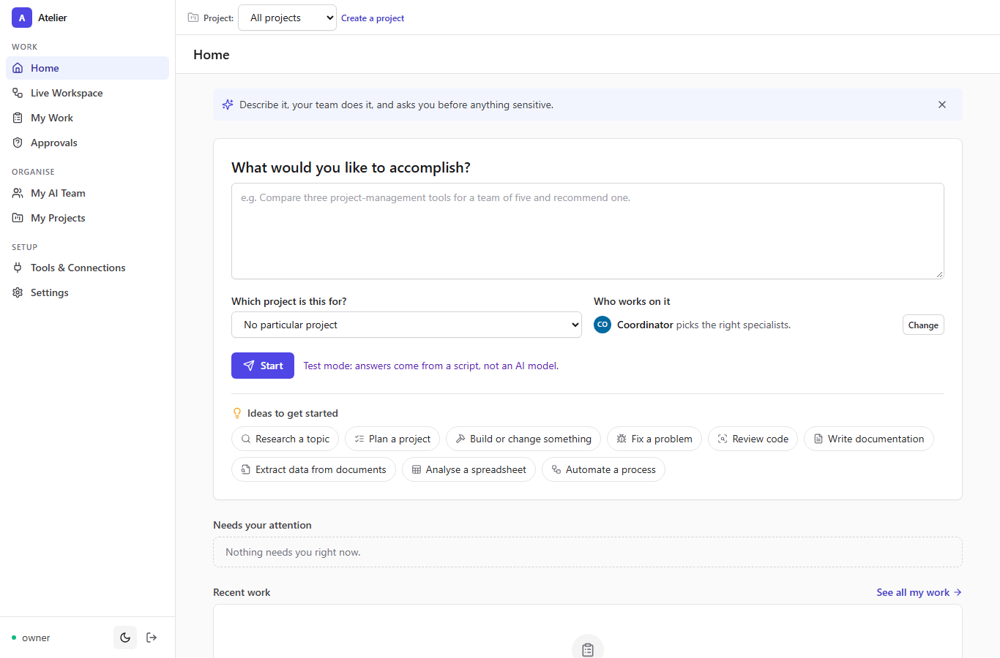

## 2. Direct mode: straight to the engineer

In a project whose folder holds code, the request goes straight to the **Software Engineer**, which works on it
directly in your repository, like a Claude Code session. **Change** brings the Coordinator back when you want the
whole team.

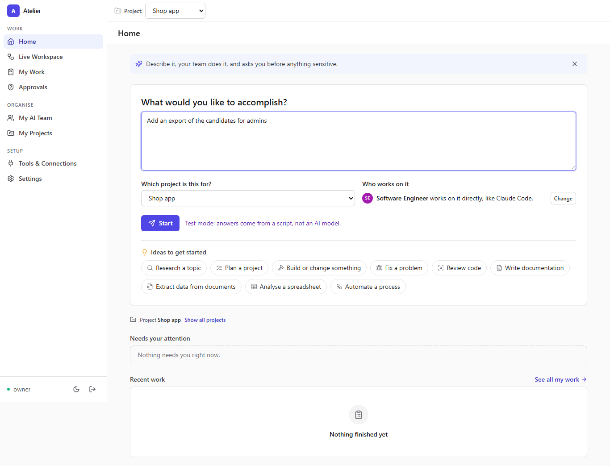

## 3. The plan: nothing starts before you approve it

For a bigger goal the Coordinator proposes a plan: the numbered steps, who does each one and what each one waits
for. **Start the plan** runs it. **Change it** takes one sentence of feedback, and the Coordinator proposes again.

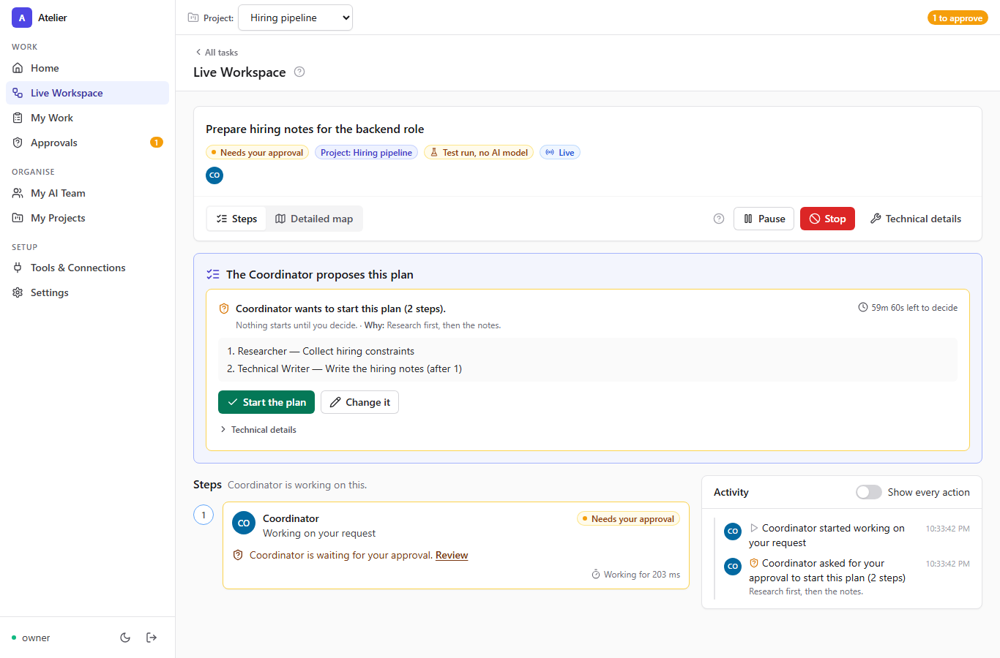

## 4. Approvals: every sensitive action, in plain words

A team member that wants to create a file, run a command or reach the web asks first. The request says who asks,
what exactly would happen (the file and its content, the command), why, and how long you have to decide. You can
approve or reject it with a message, right in the task or in the **Approvals** inbox.

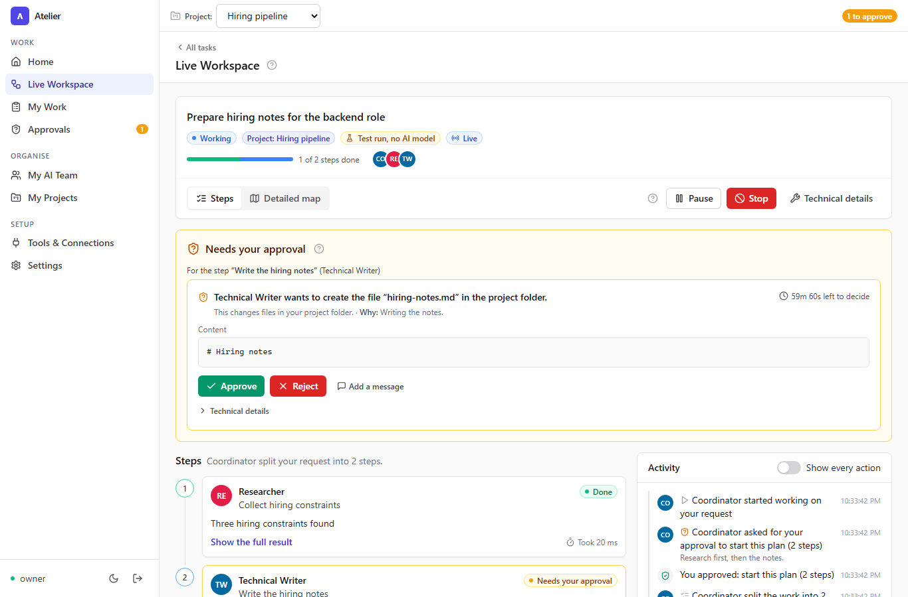

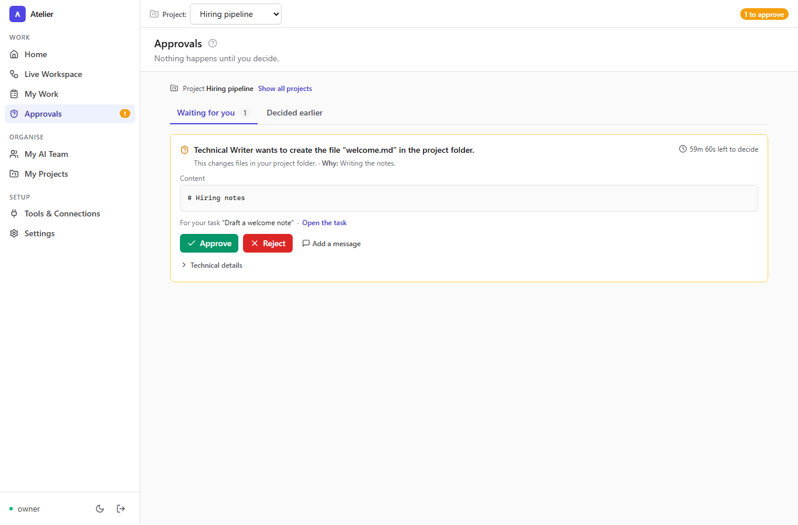

Prefer to let the work run? **Settings > Account > Approve actions automatically** turns on auto mode. Deploys,
`git push`, publishing and anything that sends data off your machine still ask, unless you also allow those.
Private folders and secret files stay closed in every mode.

## 5. Live Workspace: the result and how it was made

The final result comes first, with tables and formatting shown properly. Then come the steps, each with its own
result and what it handed to the next member, and an activity feed of everything that happened. **What next?**
continues the task with a follow-up that keeps the link to the original. You can **Pause**, **Resume** or **Stop** a
task at any time.

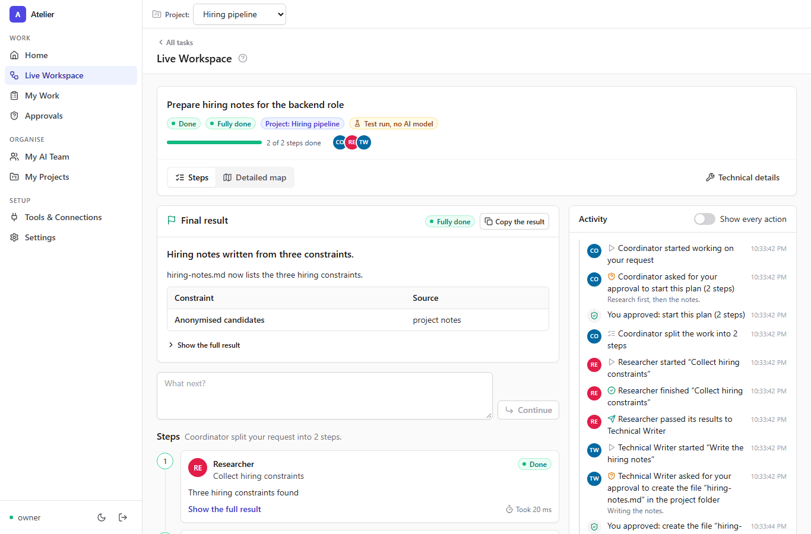

## 6. The detailed map

For experts: the whole task as a graph, with your request, each member's step, the approvals and the final result,
rebuilt from the recorded events. It looks the same after a restart.

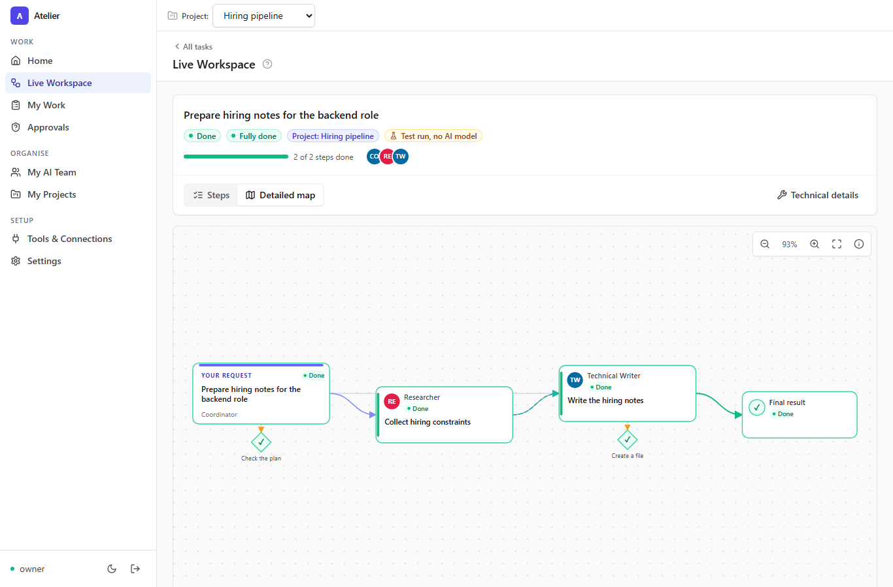

## 7. Security review of every code change

When a coding task changes files, the **Security Engineer** reviews the change on its own. It only reads, and it
can use scanners such as `pip-audit`, `bandit`, `gitleaks` and `npm audit`. It gives a verdict, and the changed
task's page shows it. A blocking review lists each finding with its severity, file, line and fix. **Fix what blocks**
hands the findings back to the engineer who made the change, in the same session, and the fix is reviewed again.

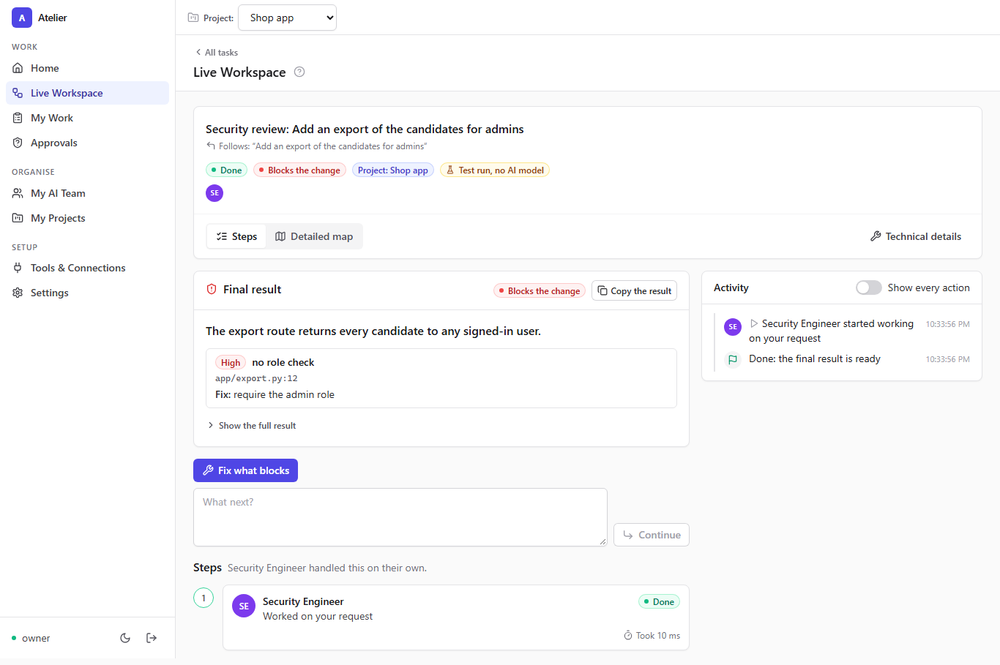

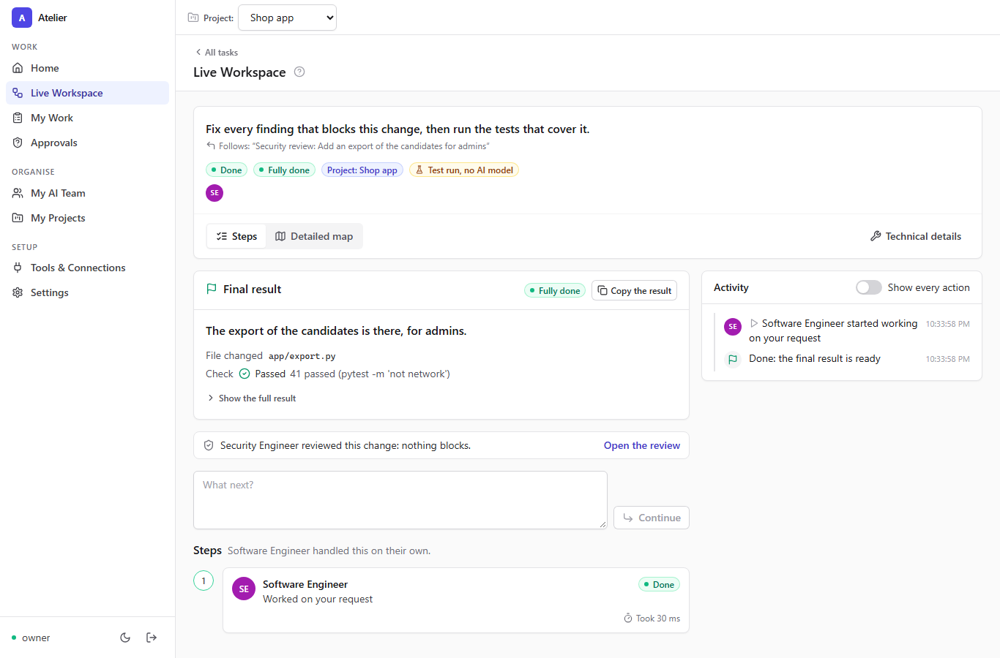

## 8. Your team, and the agent each member runs on

Each member's profile says when it helps, what to give it, what it can do (and whether it asks first), what it
won't do and what you get back. **Runs on** picks the agent it uses: Claude Code, or any ACP agent installed on
your PC.

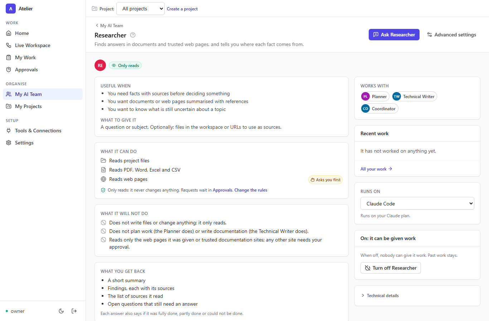

## 9. AI agents: bring the ones you have

Tools & Connections lists every agent the team can run on, whether it is installed, the command to install it and
how to sign in once. To add any other agent that speaks the Agent Client Protocol, give its command in Settings.
Atelier never asks for an API key.

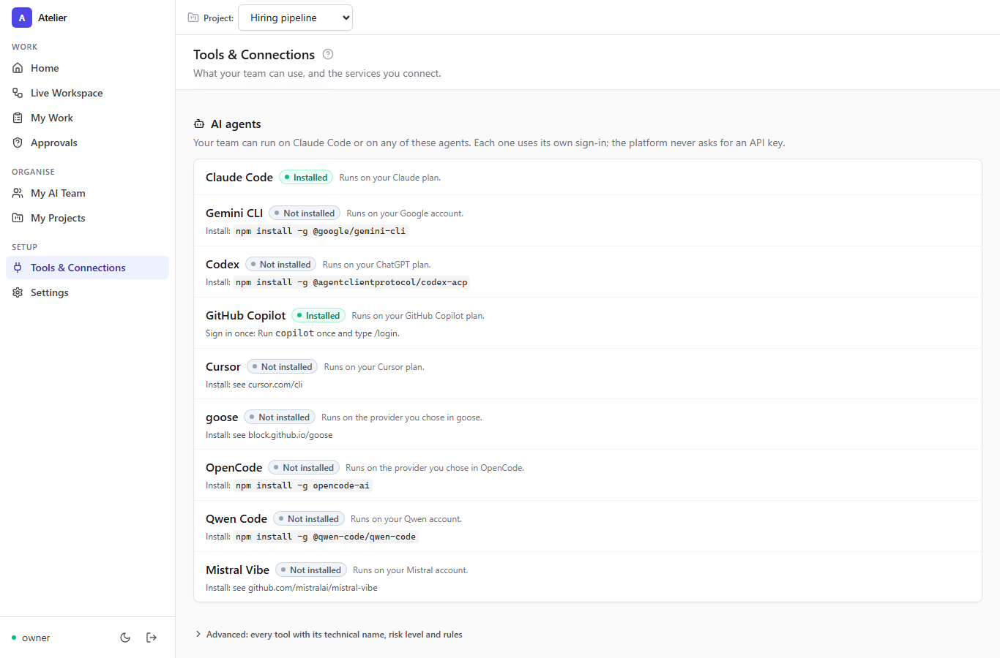

## 10. My Work: everything, searchable

My Work lists every task, its follow-ups and its status. You can filter by status, search, and open any task to see
exactly what happened.

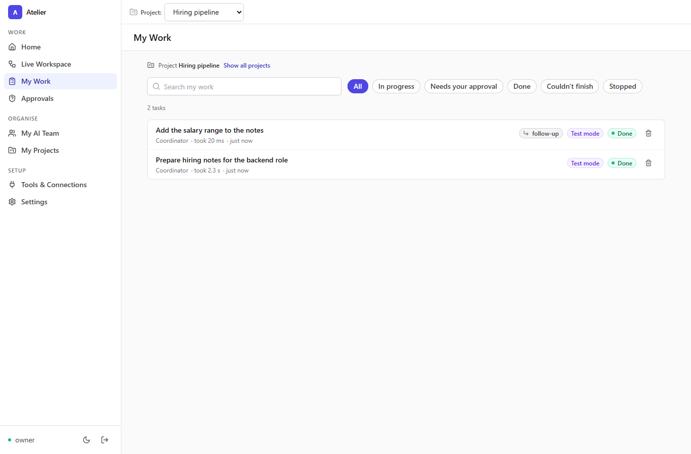

## 11. Light and dark

Screens are light by default. One click switches to dark, and Atelier remembers the choice.

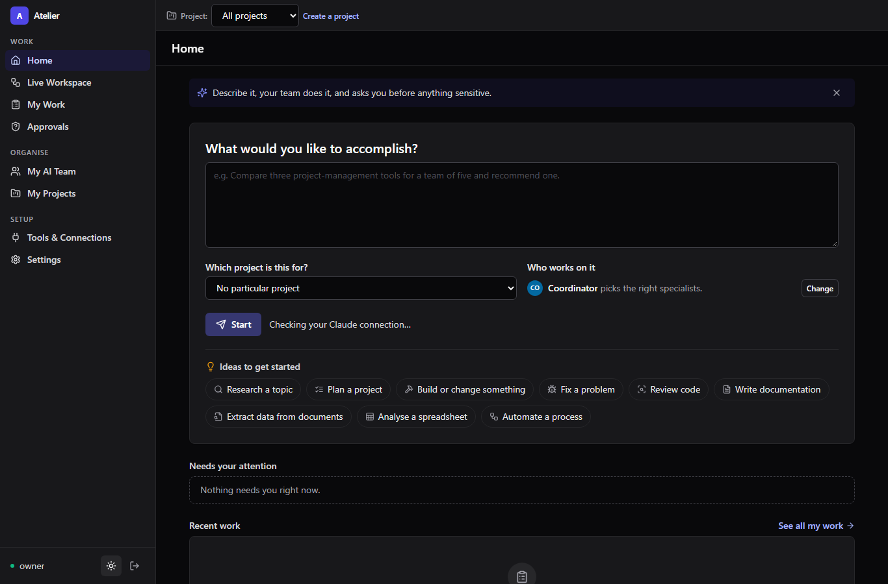
